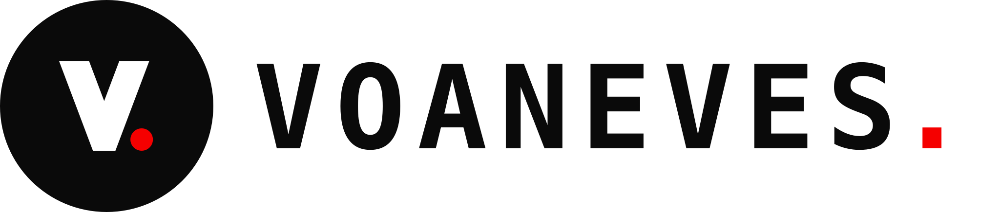

<p align="center">
  <picture>
    <source media="(prefers-color-scheme: dark)" srcset="logo/lockup-horizontal-reverse.svg">
    <source media="(prefers-color-scheme: light)" srcset="logo/lockup-horizontal.svg">
    
  </picture>
</p>

<p align="center">
  <strong>Signal, not noise.</strong> — Brand identity, DTCG design tokens, layered CSS, vanilla ES modules, subsetted fonts, SVG icons, and Astro components for <a href="https://voaneves.com">voaneves.com</a>.
</p>

<p align="center">
  <a href="https://github.com/voaneves/brand/actions/workflows/ci.yml"></a>
  <a href="LICENSES.md"></a>
  <a href="package.json"></a>
  <a href="tests/contrast-pairs.json"></a>
  <a href="https://voaneves.com"></a>
</p>

<p align="center">
  <a href="https://voaneves.com">voaneves.com</a> ·
  <a href="https://github.com/voaneves">github.com/voaneves</a> ·
  <a href="https://github.com/voaneves/site">voaneves/site</a> ·
  <a href="https://www.linkedin.com/in/voaneves/">LinkedIn</a>
</p>

---

## Distribution & Current Usage

`@voaneves/brand` (`v1.0.0`) is the single source of truth for Victor Neves's visual identity and UI primitives. It is actively consumed in production by [`voaneves/site`](https://github.com/voaneves/site) ([voaneves.com](https://voaneves.com)) via a vendored tarball (`vendor/voaneves-brand-1.0.0.tgz` installed as `"file:./vendor/voaneves-brand-1.0.0.tgz"`).

Public npm registry publishing via OIDC trusted provenance (configured in [`.github/workflows/release.yml`](.github/workflows/release.yml), [ADR 0003](docs/decisions/0003-distribution-npm.md)) is ready and pending the initial `v1.0.0` release tag; `@voaneves/brand` is not yet live on npmjs.org.

### Consuming Styles, Tokens, JS & Astro Components

```css
/* Import individual CSS layers (as used in voaneves/site) */
@import "@voaneves/brand/css/tokens.css";
@import "@voaneves/brand/css/base.css";
@import "@voaneves/brand/css/components.css";

/* Or load the full layered bundle (includes fonts, tokens, base, type, components) */
@import "@voaneves/brand/css/all.css";
```

```js
import { tokens } from '@voaneves/brand/tokens';
import { initTheme } from '@voaneves/brand/js/theme';
import { initCursor } from '@voaneves/brand/js/cursor';

initTheme();
initCursor();
```

```astro
---
import Logo from '@voaneves/brand/astro/Logo.astro';
import Icon from '@voaneves/brand/astro/Icon.astro';
import Credit from '@voaneves/brand/astro/Credit.astro';
---

<Logo variant="signature" tone="mono" />
<Icon name="github" size={20} label="GitHub" />
<Credit variant="inline" lang="en" utmSource="voaneves-site" />
```

---

## Visual Identity

### Brand Mark & Wordmark

<p>
  <picture>
    <source media="(prefers-color-scheme: dark)" srcset="logo/mark-reverse.svg">
    <source media="(prefers-color-scheme: light)" srcset="logo/mark.svg">
    
  </picture>
</p>

- **Mark — Concept B (Sinal):** Geometric circular disc (`viewBox 0 0 512 512`) combining an incised `3:8` italic `V` with a `#f50000` signal dot (`cx=340, cy=337, r=27`). Maintain `0.25D` (`128` units) clear space around the disc and respect minimum digital sizes (`16px` app icons, `24px` editorial/horizontal lockups). See [`docs/03-logo.md`](docs/03-logo.md) and [ADR 0004](docs/decisions/0004-logo-concept-b-sinal.md).
- **Wordmark — `VOANEVES.`:** Uppercase `VOANEVES` set in JetBrains Mono Bold with the trailing full stop in Sinal (`#f50000`), without registration or trademark symbols ([ADR 0002](docs/decisions/0002-wordmark-without-registered-mark.md)).

### Palette & Hard Contrast Rule

Three core brand colors ([ADR 0001](docs/decisions/0001-palette-and-type.md), [`docs/spec-values.md`](docs/spec-values.md)):

| Color | Light | Dark | Role |
|---|---|---|---|
| **Tinta** | `#0a0a0a` | `#0a0a0a` | Ink, dark ground, inverse surfaces, text on Sinal |
| **Creme** | `#f4ead4` | `#e8dec5` (text) | Paper light ground (`#f4ead4`), dark-mode body text (`#e8dec5`) |
| **Sinal** | `#f50000` | `#ff3838` | Single brand accent, focus ring, signal surface, dot indicators |
| **Sinal Ink** | `#b80000` | `#ff5a5a` | Small red text (links, errors, section indices) on light/dark grounds |

> **Hard Contrast Rule:** Text on Sinal (`#f50000` / `#ff3838`) is **always Tinta (`#0a0a0a`)**. White (`#ffffff`) and Creme (`#f4ead4`) text on Sinal stay below `4.5:1` and are strictly forbidden and blocked in CI.

### Typography

- **Fraunces:** Variable optical-size display and editorial headings.
- **Schibsted Grotesk:** Body copy and UI text.
- **JetBrains Mono:** Labels, metadata/tabular numbers, code blocks, and the `VOANEVES.` wordmark.

The type scale defines **19 `.vn-type-*` styles** (`Display`, `Text`, `Label`) and ships as **5 subsetted WOFF2 files** with metric-matched fallback declarations (`<= 35 KB` per critical preload font, `<= 60 KB` combined preload budget).

---

## Architecture & Package Exports

- **3-Tier DTCG Tokens (`tokens/src/{ref,sys,component}`):** Hand-authored W3C/DTCG JSON compiled by Style Dictionary v5 (`scripts/build-tokens.mjs`) into `dist/css/tokens.css` (using native CSS `light-dark()`), `dist/css/type.css`, `dist/tokens.js`, `dist/tokens.d.ts`, `dist/tokens.json`, and `dist/board/tokens.json`.
- **Layered CSS (`css/src/`):** Cascade enforced via `@layer vn.reset, vn.tokens, vn.base, vn.type, vn.components, vn.utilities;`. Component CSS is isolated from primitive `--vn-ref-*` tokens (verified automatically on build and test).
- **Zero-Dependency ES Modules (`js/src/`):** 6 standalone vanilla modules: `cursor.js` (`<= 1.5 KB` gzip), `journey.js`, `magnetic.js`, `marquee.js`, `reveal.js`, and `theme.js`.
- **Icons & App Icons (`icons/`, `app-icons/`):** 19 normalized `1024x1024` `currentColor` SVGs compiled to `dist/icons/{name}.svg` and `dist/icons/sprite.svg` (`#vn-icon-{name}`), plus `dist/app-icons/` (`favicon.ico`, `favicon.svg`, `apple-touch-icon.png`, `icon-192.png`, `icon-512.png`, `maskable-512.png`).
- **Astro Source Components (`astro/`):** `Logo.astro`, `Icon.astro`, and `Credit.astro` (optional peer dependency `astro >= 7`), plus standalone `dist/credit/credit.html`.

### `package.json` Exports (15 Entry Points)

| Export | Target | Purpose |
|---|---|---|
| `@voaneves/brand/css/tokens.css` | `./dist/css/tokens.css` | Light/dark semantic & component custom properties |
| `@voaneves/brand/css/fonts.css` | `./dist/css/fonts.css` | `@font-face` rules & metric-matched fallbacks |
| `@voaneves/brand/css/base.css` | `./dist/css/base.css` | Reset, 19 `.vn-type-*` classes, and base rules |
| `@voaneves/brand/css/components.css` | `./dist/css/components.css` | `.vn-*` UI component styles |
| `@voaneves/brand/css/all.css` | `./dist/css/all.css` | Ordered `@layer` bundle importing all CSS layers |
| `@voaneves/brand/tokens` | `./dist/tokens.js` (+ `.d.ts`) | Typed JavaScript token map |
| `@voaneves/brand/tokens.json` | `./dist/tokens.json` | Flat compiled JSON tokens |
| `@voaneves/brand/js/*` | `./dist/js/*.js` | `cursor`, `journey`, `magnetic`, `marquee`, `reveal`, `theme` |
| `@voaneves/brand/fonts/*` | `./fonts/*` | 5 subsetted WOFF2 files & `OFL-*.txt` notices |
| `@voaneves/brand/icons/*` | `./dist/icons/*` | 19 normalized SVGs & `sprite.svg` |
| `@voaneves/brand/logo/*` | `./dist/logo/*` | Canonical SVG marks, wordmarks, and lockups |
| `@voaneves/brand/app-icons/*` | `./dist/app-icons/*` | Favicons, Apple touch, and PWA manifest icons |
| `@voaneves/brand/astro/*` | `./astro/*` | `Logo.astro`, `Icon.astro`, `Credit.astro` |
| `@voaneves/brand/credit` | `./dist/credit/credit.html` | Standalone HTML footer credit snippet |
| `@voaneves/brand/package.json` | `./package.json` | Package metadata |

---

## Quality Gates & Verification

Requires **Node.js `>=24`** (see [`.nvmrc`](.nvmrc)). Because `dist/` is gitignored and built from source, run the build before executing the test suite:

```bash
npm ci
npm run build
npm test
```

Automated checks executed by `npm test` (`node --test tests/*.test.js && npm run check:exports`):

| Check | Coverage |
|---|---|
| [`tests/contrast.test.js`](tests/contrast.test.js) | Validates **29 required** WCAG 2.2 AA pairs across `light` & `dark` (`>= 4.5:1` normal text, `>= 3.0:1` large text/UI/focus/lines) and **2 banned pairs** (`ref-white` and `cream` on `surface-signal` must stay `< 4.5:1`). |
| [`tests/board-grammar.test.js`](tests/board-grammar.test.js) | Validates compiled token outputs, board JSON grammar & caps (`<= 12` families, `<= 600` colors, 19 type styles), and ensures component tokens never directly alias `{ref.*}`. |
| [`tests/fonts.test.js`](tests/fonts.test.js) | Verifies all 5 WOFF2 magic headers, 3 `OFL-*.txt` notices, `dist/css/fonts.css` rules, and preload budgets (`<= 35 KB` each / `<= 60 KB` combined). |
| [`tests/icons.test.js`](tests/icons.test.js) | Verifies 19 normalized `1024x1024` `currentColor` SVGs, `sprite.svg` symbols, `dist/app-icons/`, and `dist/logo/` assets. |
| [`tests/exports.test.js`](tests/exports.test.js) & [`scripts/check-exports.mjs`](scripts/check-exports.mjs) | Verifies all 15 `package.json` export entries resolve to non-empty files, zero `--vn-ref-` leaks in `components.css`, `cursor.js <= 1.5 KB` gzip, Astro components, `credit.html`, and 14 board chapters / 7 previews. |

---

## Repository Map

| Path | Contents |
|---|---|
| `tokens/src/` | 3-tier DTCG token sources (`ref/`, `sys/`, `component/`) |
| `css/src/` | Reset, base, and `.vn-*` component CSS sources |
| `js/src/` | 6 zero-dependency ES modules (`cursor`, `journey`, `magnetic`, `marquee`, `reveal`, `theme`) |
| `astro/` | `Logo.astro`, `Icon.astro`, and `Credit.astro` source components |
| `fonts/` | Subsetted `.woff2` font files and `OFL-*.txt` license notices |
| `icons/` | 19 normalized source SVGs (`svg/`) and per-icon attribution (`icons/LICENSES.md`) |
| `logo/` | Canonical Concept B (Sinal) SVG marks, wordmarks, and lockups |
| `app-icons/` | Source SVG favicon and PWA/touch icon generator assets |
| `motifs/` | Auxiliary decorative SVG wave dividers |
| `board/` | Source chapters (`01`–`14`) and component HTML previews for the visual board |
| `docs/` | ADRs (`docs/decisions/`), logo guide (`docs/03-logo.md`), token spec (`docs/spec-values.md`), a11y checklist (`docs/a11y-checklist.md`), component docs, and positioning source (`docs/perfil-tecnico.md`) |
| `scripts/` | Build scripts for tokens, fonts, icons, CSS, board, and export verification |
| `tests/` | Automated contrast, board grammar, font budget, icon, and export tests |

---

## Licensing

This repository uses mixed per-asset licensing (full breakdown in [`LICENSES.md`](LICENSES.md) and [`icons/LICENSES.md`](icons/LICENSES.md)):

- **Code** (CSS, JS, build scripts, Astro components): **MIT** ([`LICENSE`](LICENSE)).
- **Fonts** (Fraunces, Schibsted Grotesk, JetBrains Mono): **SIL OFL 1.1** (`fonts/OFL-*.txt` shipped in package).
- **Icons** (`icons/svg/`): Per [`icons/LICENSES.md`](icons/LICENSES.md) — 16 Font Awesome 4 glyphs (SIL OFL 1.1 / attribution note), 2 Material Icons (`gamepad`, `translate` — Apache-2.0), and 1 IcoMoon Free glyph (`whatsapp` — CC BY 4.0).
- **Brand marks, wordmark, motifs, and photography:** **All rights reserved** (not covered by MIT; use requires permission).

---

## Links

- Portfolio: [voaneves.com](https://voaneves.com)
- GitHub Profile: [github.com/voaneves](https://github.com/voaneves)
- Portfolio Repository: [github.com/voaneves/site](https://github.com/voaneves/site)
- LinkedIn: [linkedin.com/in/voaneves](https://www.linkedin.com/in/voaneves/)
- Brand Docs: [`PLAN.md`](PLAN.md) · [`CHANGELOG.md`](CHANGELOG.md) · [`docs/decisions/`](docs/decisions/) · [`docs/03-logo.md`](docs/03-logo.md) · [`docs/spec-values.md`](docs/spec-values.md) · [`docs/a11y-checklist.md`](docs/a11y-checklist.md) · [`docs/perfil-tecnico.md`](docs/perfil-tecnico.md)
