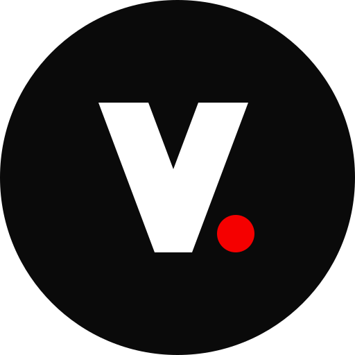
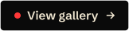
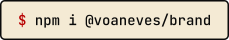
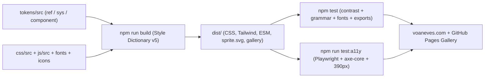

<a id="top"></a>

<div align="center">

<picture>
  <source media="(prefers-color-scheme: dark)" srcset="https://raw.githubusercontent.com/voaneves/brand/main/logo/mark-reverse.svg" />
  <source media="(prefers-color-scheme: light)" srcset="https://raw.githubusercontent.com/voaneves/brand/main/logo/mark.svg" />
  
</picture>

<h1>@voaneves/brand</h1>

<p>
  <strong>Signal, not noise. — Official brand identity, W3C DTCG 2025.10 design tokens, layered CSS, Tailwind v4 theme, vanilla ES modules, subsetted fonts, SVG icons, and Astro components.</strong><br />
  <sub>
    Single source of truth for <a href="https://voaneves.com">voaneves.com</a> &amp; all VOANEVES projects —
    <kbd>W3C DTCG</kbd> · <kbd>Style Dictionary v5</kbd> · <kbd>WCAG 2.2 AA</kbd> · <kbd>Playwright + axe-core</kbd>
  </sub>
</p>

<p>
  <a href="https://voaneves.github.io/brand/"><picture><source media="(prefers-color-scheme: dark)" srcset="https://raw.githubusercontent.com/voaneves/brand/main/assets/buttons/gallery-dark.svg" /></picture></a>
  <a href="#distribution"><picture><source media="(prefers-color-scheme: dark)" srcset="https://raw.githubusercontent.com/voaneves/brand/main/assets/buttons/npm-dark.svg" /></picture></a>
</p>

<p><sub>Need a design system like this? <a href="https://voaneves.com/en/#contact"><strong>Let's talk →</strong></a></sub></p>

<p>
  <a href="https://github.com/voaneves/brand/actions/workflows/ci.yml"></a>
  <a href="./package.json"></a>
  <a href="./tests/contrast-pairs.json"></a>
  <a href="./LICENSES.md"></a>
</p>

</div>

<picture>
  <source media="(prefers-color-scheme: dark)" srcset="https://raw.githubusercontent.com/voaneves/brand/main/assets/brand/rule-dark.svg" />
  <source media="(prefers-color-scheme: light)" srcset="https://raw.githubusercontent.com/voaneves/brand/main/assets/brand/rule-light.svg" />
  
</picture>

<details>
  <summary><strong>Contents</strong> — jump to a section</summary>

- [Live Gallery](https://voaneves.github.io/brand/)
- [Distribution &amp; Usage](#distribution)
- [Visual Identity](#visual-identity)
- [Architecture &amp; Package Exports](#architecture)
- [Quality Gates &amp; Repository Map](#quality-gates)
- [Mixed Asset Licensing](#licensing)
- [Contact](#contact)

</details>

<a id="distribution"></a>
## Distribution &amp; Usage

`@voaneves/brand` is the single source of truth for Victor Neves's visual identity, DTCG tokens, accessible UI primitives, and documentation assets across [`voaneves.com`][site] and sibling repositories[^1].

`v1.0.0` is actively consumed in production by [`voaneves/site`](https://github.com/voaneves/site) via a vendored tarball (`"file:./vendor/voaneves-brand-1.0.0.tgz"`). Public npm publishing with OIDC trusted provenance is configured in [`.github/workflows/release.yml`](.github/workflows/release.yml) ([ADR 0003](docs/decisions/0003-distribution-npm.md)).

### Consuming CSS Layers, Tailwind Theme, JS &amp; Astro Components

```css
/* Load layered CSS selectively (production pattern in voaneves/site) */
@import "@voaneves/brand/css/tokens.css";
@import "@voaneves/brand/css/base.css";
@import "@voaneves/brand/css/components.css";

/* Or load the full cascade bundle */
@import "@voaneves/brand/css/all.css";
```

```css
/* Tailwind CSS v4 theme mapping (bg-surface, text-signal-ink, font-display) */
@import "tailwindcss";
@import "@voaneves/brand/css/all.css";
@import "@voaneves/brand/tailwind/theme.css";
```

```js
import { tokens } from '@voaneves/brand/tokens';
import { initTheme } from '@voaneves/brand/js/theme';
import { initCursor } from '@voaneves/brand/js/cursor';

initTheme();
initCursor();
```

```astro
---
import Logo from '@voaneves/brand/astro/Logo.astro';
import Icon from '@voaneves/brand/astro/Icon.astro';
import Credit from '@voaneves/brand/astro/Credit.astro';
---

<Logo variant="signature" tone="mono" />
<Icon name="github" size={20} label="GitHub" />
<Credit variant="inline" lang="en" utmSource="voaneves-site" />
```

### Use as a Claude Code Plugin

This repository ships a Claude Code plugin marketplace exposing the `voaneves-design-system` plugin (tokens, type scale, logo rules, and accessibility checks):

```text
/plugin marketplace add voaneves/brand
/plugin install voaneves-design-system@voaneves
```

<a id="visual-identity"></a>
## Visual Identity

<div align="center">
  <picture>
    <source media="(prefers-color-scheme: dark)" srcset="https://raw.githubusercontent.com/voaneves/brand/main/logo/lockup-horizontal-reverse.svg" />
    <source media="(prefers-color-scheme: light)" srcset="https://raw.githubusercontent.com/voaneves/brand/main/logo/lockup-horizontal.svg" />
    
  </picture>
</div>

- **Mark — Concept B (Sinal):** Geometric circular disc (`viewBox="0 0 512 512"`) combining an incised `3:8` italic `V` with a Sinal dot (`cx=340, cy=337, r=27`). Keep `0.25D` (`128` units) clear space around the disc and respect minimum digital sizes (`16px` app icons, `24px` lockups). See [`docs/03-logo.md`](docs/03-logo.md) and [ADR 0004](docs/decisions/0004-logo-concept-b-sinal.md).
- **Wordmark — `VOANEVES.`:** Uppercase `VOANEVES` set in JetBrains Mono Bold with the trailing full stop in Sinal (`#f50000`), without registration marks ([ADR 0002](docs/decisions/0002-wordmark-without-registered-mark.md)).
- **Typography:** **Fraunces** (optical display serif), **Schibsted Grotesk** (UI and body), and **JetBrains Mono** (labels, metadata, code, wordmark) — defining **19 `.vn-type-*` styles** shipped across **5 subsetted WOFF2 files** (`<= 35 KB` each, `<= 60 KB` combined preload).

| Color | Light | Dark | Role |
| :--- | :--- | :--- | :--- |
| **Tinta** | `#0a0a0a` | `#0a0a0a` | Primary ink, dark ground, inverse cards, **mandatory text on Sinal** |
| **Creme** | `#f4ead4` | `#e8dec5` | Light paper ground (`#f4ead4`), dark-mode body text (`#e8dec5`) |
| **Sinal** | `#f50000` | `#ff3838` | Single accent surface, focus ring, dot indicators |
| **Sinal Ink** | `#b80000` | `#ff5a5a` | Small red text (links, errors, indices) verified AA on light &amp; dark grounds |

> [!IMPORTANT]
> **Hard Contrast Rule enforced in CI:** Text on Sinal (`#f50000` / `#ff3838`) is **always Tinta (`#0a0a0a`)**. White (`#ffffff`) and Creme (`#f4ead4`) text on Sinal stay below `4.5:1` and are explicitly blocked by [`tests/contrast.test.js`](tests/contrast.test.js) and [`.github/contrast/contrast.config.json`](.github/contrast/contrast.config.json).

$$CR = \frac{L_{\text{lighter}} + 0.05}{L_{\text{darker}} + 0.05} \ge 4.5 \quad (\text{normal text}) \qquad CR \ge 3.0 \quad (\text{large text / UI / focus})$$

<a id="architecture"></a>
## Architecture &amp; Package Exports



### Core Layers &amp; Tooling

- **3-Tier W3C DTCG Tokens (`tokens/src/{ref,sys,component}`):** Compiled by Style Dictionary v5 into `dist/css/tokens.css` (`light-dark()`), `dist/css/type.css`, `dist/tokens.js` (`.d.ts`), `dist/tokens.json`, `dist/tailwind/theme.css`, and `dist/board/tokens.json`.
- **Layered Component CSS (`css/src/`):** Ordered via `@layer vn.reset, vn.tokens, vn.base, vn.type, vn.components, vn.utilities;`, split cleanly across `base.css`, `reset.css`, `components.css`, `content.css`, `feedback.css`, `forms.css`, `navigation.css`, and `structure.css` with zero direct `--vn-ref-*` leaks.
- **Zero-Dependency ES Modules (`js/src/`):** Standalone browser modules (`cursor.js` budgeted `<= 1.5 KB` gzip, `drawer.js`, `journey.js`, `magnetic.js`, `marquee.js`, `reveal.js`, `theme.js`, `toast.js`, `tooltip.js`) supporting keyboard traps, `Esc` dismissal, and reduced motion.
- **Icons, Templates &amp; Gallery:** `19` normalized `1024×1024` `currentColor` SVGs (`dist/icons/sprite.svg`), PWA icons (`dist/app-icons/`), office &amp; social templates (`templates/` — `.docx`, `.pptx`, `.xlsx`, `og-image`, `email-signature`), and a static component gallery published via [`.github/workflows/gallery.yml`](.github/workflows/gallery.yml) at [voaneves.github.io/brand](https://voaneves.github.io/brand/).

<details>
  <summary><strong>Package Exports (16 Entry Points in <code>package.json</code>)</strong></summary>

| Export | Target | Purpose |
| :--- | :--- | :--- |
| `@voaneves/brand/css/tokens.css` | `./dist/css/tokens.css` | Light/dark semantic &amp; component custom properties |
| `@voaneves/brand/css/fonts.css` | `./dist/css/fonts.css` | `@font-face` rules &amp; metric-matched fallbacks |
| `@voaneves/brand/css/base.css` | `./dist/css/base.css` | Reset, `19` `.vn-type-*` classes, and base typography |
| `@voaneves/brand/css/components.css` | `./dist/css/components.css` | Layered `.vn-*` UI component primitives |
| `@voaneves/brand/css/all.css` | `./dist/css/all.css` | Ordered `@layer` bundle importing all CSS layers |
| `@voaneves/brand/tailwind/theme.css` | `./dist/tailwind/theme.css` | Tailwind CSS v4 `@theme` design token bridge |
| `@voaneves/brand/tokens` | `./dist/tokens.js` (+ `.d.ts`) | Typed JavaScript token map |
| `@voaneves/brand/tokens.json` | `./dist/tokens.json` | Flat compiled JSON tokens |
| `@voaneves/brand/js/*` | `./dist/js/*.js` | Interactive browser ES modules (`cursor`, `drawer`, `toast`, `tooltip`, ...) |
| `@voaneves/brand/fonts/*` | `./fonts/*` | `5` subsetted WOFF2 files &amp; `OFL-*.txt` notices |
| `@voaneves/brand/icons/*` | `./dist/icons/*` | `19` normalized SVGs &amp; unified `sprite.svg` |
| `@voaneves/brand/logo/*` | `./dist/logo/*` | Canonical SVG marks, wordmarks, and lockups |
| `@voaneves/brand/app-icons/*` | `./dist/app-icons/*` | Favicons, Apple touch, and PWA manifest icons |
| `@voaneves/brand/astro/*` | `./astro/*` | `Logo.astro`, `Icon.astro`, and `Credit.astro` |
| `@voaneves/brand/credit` | `./dist/credit/credit.html` | Standalone HTML footer credit snippet |
| `@voaneves/brand/package.json` | `./package.json` | Package metadata |

</details>

<a id="quality-gates"></a>
## Quality Gates &amp; Repository Map

Requires **Node.js 24** ([`.nvmrc`](.nvmrc)). Because `dist/` is gitignored and built from source, run the build before executing the unit and accessibility suites:

```bash
npm ci
npm run build
npm test        # contrast, grammar, fonts, icons, coverage & export checks
npm run test:a11y
```

| Check Suite | Coverage |
| :--- | :--- |
| [`tests/contrast.test.js`](tests/contrast.test.js) | Validates required WCAG 2.2 AA pairs across `light` &amp; `dark` plus banned white/cream pairs on Sinal |
| [`tests/board-grammar.test.js`](tests/board-grammar.test.js) | Validates board JSON caps, component coverage, and ensures components never directly alias `{ref.*}` |
| [`tests/fonts.test.js`](tests/fonts.test.js) | Verifies all `5` WOFF2 files, `OFL-*.txt` notices, `@font-face` rules, and `<= 60 KB` combined preload budget |
| [`tests/icons.test.js`](tests/icons.test.js) | Verifies `19` normalized `1024×1024` SVGs, `sprite.svg` symbols, `dist/app-icons/`, and `dist/logo/` |
| [`tests/a11y/`](tests/a11y/) | Playwright + `axe-core` checks across `390px` mobile viewports, keyboard navigation, focus states, and `prefers-reduced-motion` |

<details>
  <summary><strong>Repository Map &amp; Governance Docs</strong></summary>

- [`tokens/src/`](tokens/src/) · [`css/src/`](css/src/) · [`js/src/`](js/src/) · [`astro/`](astro/) — core package sources
- [`docs/components/`](docs/components/README.md) · [`docs/patterns/`](docs/patterns/forms.md) — `31` component specs and form/navigation patterns
- [`docs/voice-and-tone.md`](docs/voice-and-tone.md) · [`docs/data-viz.md`](docs/data-viz.md) — editorial voice (PT/EN) and chart palettes
- [`docs/readme-spec.md`](docs/readme-spec.md) · [`docs/a11y-checklist.md`](docs/a11y-checklist.md) · [`docs/perfil-tecnico.md`](docs/perfil-tecnico.md) — family README layout, accessibility checklist, and positioning baseline
- [`CONTRIBUTING.md`](CONTRIBUTING.md) · [`docs/governance/`](docs/governance/naming.md) — Conventional Commits, naming rules, and deprecation policy
- [`templates/`](templates/README.md) · [`board/`](board/README.md) — Office/OG/signature templates and visual brand board

</details>

<a id="licensing"></a>
## Mixed Asset Licensing

This repository uses mixed per-asset licensing (complete manifest in [`LICENSES.md`](LICENSES.md) and [`icons/LICENSES.md`](icons/LICENSES.md)):

- **Code** (`css/`, `js/`, `astro/`, build scripts): **MIT License** ([`LICENSE`](LICENSE)).
- **Typography** (Fraunces, Schibsted Grotesk, JetBrains Mono): **SIL OFL 1.1** (`fonts/OFL-*.txt` bundled).
- **Icons** (`icons/svg/`): Per [`icons/LICENSES.md`](icons/LICENSES.md) — 16 Font Awesome 4 glyphs (SIL OFL 1.1), 2 Material Icons (`gamepad`, `translate` — Apache-2.0), and 1 IcoMoon Free glyph (`whatsapp` — CC BY 4.0).
- **Brand marks, wordmark, motifs, and photography:** **All rights reserved** (excluded from MIT; permission required).

<a id="contact"></a>
## Contact

<p>
  <a href="https://voaneves.com/en/#contact"><picture><source media="(prefers-color-scheme: dark)" srcset="https://raw.githubusercontent.com/voaneves/brand/main/assets/buttons/hire-dark.svg" /></picture></a>
  <a href="https://voaneves.com/en/"><picture><source media="(prefers-color-scheme: dark)" srcset="https://raw.githubusercontent.com/voaneves/brand/main/assets/buttons/site-dark.svg" /></picture></a>
</p>

<a href="https://www.linkedin.com/in/voaneves/">LinkedIn</a> · <a href="mailto:victorneves478@gmail.com">E-mail</a>

<div align="center">
  
</div>

<p align="center"><sub>Code licensed under <a href="./LICENSE">MIT</a> (see <a href="./LICENSES.md">LICENSES.md</a> for mixed asset rights) © 2026 <a href="https://github.com/voaneves">Victor Neves</a> · <strong>VOANEVES.</strong></sub></p>

<p align="center"><sub><a href="#top">↑ Back to top</a></sub></p>

[^1]: Every semantic and inverse contrast pair is also auditable against W3C DTCG 2025.10 directly via [`dtcg-contrast`](https://github.com/voaneves/dtcg-contrast).

[site]: https://voaneves.com
